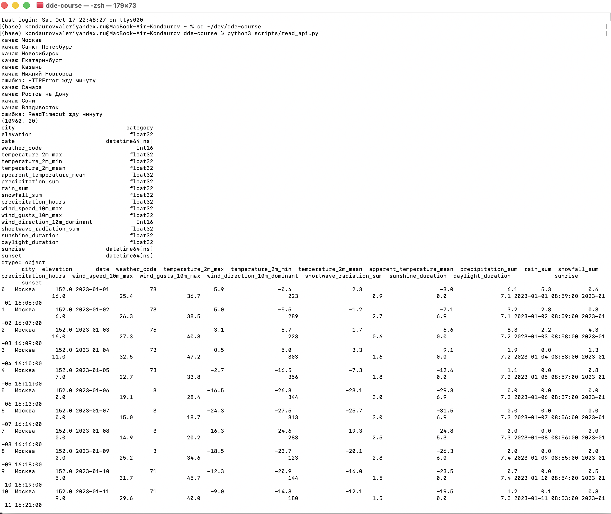

# Скрипты

## read_api.py

Собирает датасет погоды по городам России через публичное API Open-Meteo (https://open-meteo.com/en/docs/historical-weather-api). Ключ не нужен, API бесплатное.

Что качается: дневная погода за 2023-2025 годы для 10 городов (Москва, Питер, Новосибирск, Екатеринбург, Казань, Нижний, Самара, Ростов, Сочи, Владивосток). На каждый город один запрос с координатами, потом все склеивается в одну таблицу.

Если API отвечает 429 (лимит запросов) или падает по таймауту, скрипт ждет минуту и пробует еще раз.

Запуск из корня репозитория:

```bash
python scripts/read_api.py
```

Результат сохраняется в `data/weather_cities.csv` (в git не попадает).

### Что в датасете

Примерно 11 тыс строк (10 городов * 1096 дней) и 20 столбцов:

- city - город
- elevation - высота над уровнем моря, м
- date - дата
- weather_code - код погоды WMO (0 ясно, 3 пасмурно, 61-65 дождь, 71-75 снег и тд)
- temperature_2m_max / min / mean - температура за день, °C
- apparent_temperature_mean - ощущается как, °C
- precipitation_sum - осадки всего, мм
- rain_sum - дождь, мм
- snowfall_sum - снег, см
- precipitation_hours - сколько часов шли осадки
- wind_speed_10m_max - макс скорость ветра, км/ч
- wind_gusts_10m_max - макс порывы, км/ч
- wind_direction_10m_dominant - преобладающее направление ветра, градусы
- shortwave_radiation_sum - солнечная радиация, МДж/м²
- sunshine_duration - сколько светило солнце, часы
- daylight_duration - длина светового дня, часы
- sunrise, sunset - восход и закат (местное время)

### Типы

- date, sunrise, sunset в datetime
- city в category
- weather_code и направление ветра в Int16
- солнце и световой день пришли в секундах, перевел в часы
- остальные числа в float32

### Выдача


